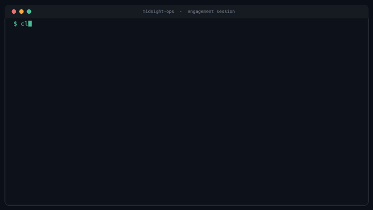

# 🌒 midnight-ops

> **Authorization-first red-team & penetration-testing skill pack for AI coding agents — Claude and Codex.**


---

> ### ⚠️ Authorized use only
> **midnight-ops** is built for licensed security professionals operating under **explicit, written permission**. Only use it against systems you own or have a signed contract/scope to test. Unauthorized access to computer systems is illegal — you are solely responsible for staying within scope and within the law.

---

## 🎬 Demo



> A scripted, fully sanitized session: the **authorization gate** fires first, scope is
> locked to one in-scope host, a methodology checklist is built, a sample finding is
> recorded with CVSS and ATT&CK tags, and a report is assembled.
> ▶️ [Watch the MP4](assets/demo.mp4) for the full-motion version. The demo is rendered
> reproducibly by [`scripts/render-demo.py`](scripts/render-demo.py) via the
> **render-demo** GitHub Actions workflow.

## 🧭 Overview

**midnight-ops** packages structured offensive-security *methodology* into a reusable skill that AI coding agents (Claude via Agent Skills, and Codex via `AGENTS.md`) can load to behave like a disciplined red-team assistant.

Instead of ad-hoc prompting, it gives the agent a consistent playbook: scope and rules-of-engagement intake, reconnaissance planning, methodology checklists (aligned to **PTES**, **OWASP**, **NIST 800-115**, and **MITRE ATT&CK**), evidence capture, and clean report generation.

The focus is on **planning, methodology, documentation, and reporting** — the parts of an engagement where an organized assistant saves the most time — while a human operator stays in control of every action taken against a target. It does **not** produce exploit code, payloads, or operational attack commands.

## ✨ Features

- 📋 **Scope & ROE intake** — captures target scope, authorization, and rules of engagement *before* anything else.
- 🔭 **Recon & enumeration planning** — turns objectives into structured, methodology-backed task lists.
- 🧩 **Framework-aligned checklists** — PTES, OWASP WSTG / MASVS, NIST 800-115, and MITRE ATT&CK mappings.
- 📝 **Evidence & finding tracking** — consistent notes and reproducible finding records.
- 📊 **Report generation** — executive summary plus technical findings with CVSS severity and remediation guidance.
- 🛡️ **Hard authorization gate** — refuses target-specific work until written authorization and scope are confirmed.
- 🤝 **Dual-agent** — ready for both Claude Agent Skills (`skill/SKILL.md`) and Codex (`AGENTS.md`).

## 🤖 Supported agents

| Agent  | Integration                      |
| ------ | -------------------------------- |
| Claude | Agent Skill (`skill/SKILL.md`)   |
| Codex  | Prompt profile (`AGENTS.md`)     |

## 🗂️ Repository structure

```text
midnight-ops/
├─ skill/
│  └─ SKILL.md                 # canonical Claude Agent Skill (authorization gate + workflow)
├─ AGENTS.md                   # Codex / agent prompt profile (mirrors the skill)
├─ methodology/                # framework-aligned checklists & references
│  ├─ ptes.md                  # PTES phase checklist
│  ├─ owasp-wstg.md            # Web Security Testing Guide checklist
│  ├─ owasp-masvs.md           # Mobile app security checklist
│  ├─ nist-800-115.md          # NIST technical assessment checklist
│  └─ mitre-attack.md          # ATT&CK tactic mapping reference
├─ templates/
│  ├─ rules-of-engagement.md   # ROE / authorization intake
│  ├─ engagement-notes.md      # running notes + finding records
│  └─ report-template.md       # executive + technical report
├─ examples/
│  └─ sanitized-walkthrough.md # end-to-end fictional engagement
├─ scripts/
│  └─ render-demo.py           # renders the README demo frames
├─ .github/workflows/          # lint, link-check, and render-demo CI
└─ assets/                     # README demo (GIF + MP4)
```

## 🚀 Getting started

1. **Clone** the repository.
2. **Load the skill** into your agent:
   - **Claude** — add `skill/SKILL.md` as an Agent Skill.
   - **Codex** — point the agent at `AGENTS.md`.
3. **Confirm authorization** — fill in [`templates/rules-of-engagement.md`](templates/rules-of-engagement.md). The assistant will not plan anything target-specific until scope and written authorization are in place.
4. **Run the engagement** — the assistant builds the methodology-backed plan and keeps notes, findings, and the report organized while *you* execute every action against the target.

See the [sanitized walkthrough](examples/sanitized-walkthrough.md) for a complete example.

## 🛣️ Roadmap

- [x] Publish `skill/SKILL.md`
- [x] Methodology checklist library (PTES / OWASP WSTG & MASVS / NIST 800-115 / MITRE ATT&CK)
- [x] Report & rules-of-engagement templates
- [x] Sanitized example engagement
- [x] Codex prompt profile (`AGENTS.md`)
- [ ] Cloud (CSP) and container/Kubernetes methodology checklists
- [ ] Machine-readable finding export (JSON / SARIF)
- [ ] Additional sanitized examples (mobile, internal network)

## ⚖️ Legal & ethical use

This project is intended **solely** for authorized security testing, education, and defensive research. Unauthorized access to computer systems is illegal in most jurisdictions. By using **midnight-ops** you agree that you are solely responsible for obtaining proper authorization and complying with all applicable laws. The maintainers assume no liability for misuse. See [`SECURITY.md`](SECURITY.md).

## 🤝 Contributing

Issues and pull requests are welcome — especially methodology references, checklist improvements, and report templates. Please read [`CONTRIBUTING.md`](CONTRIBUTING.md) and our [`CODE_OF_CONDUCT.md`](CODE_OF_CONDUCT.md). Note that offensive tooling (exploit code, payloads, attack commands) is out of scope and will not be merged.

## 📄 License

Released under the [MIT License](LICENSE).
